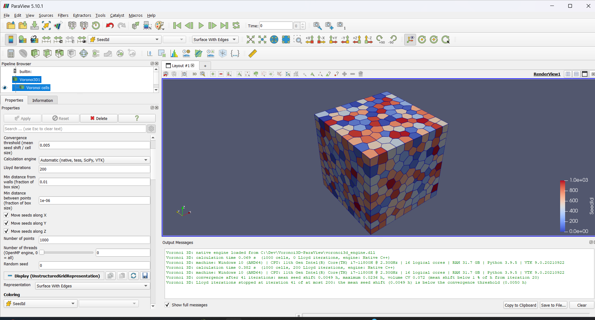

# Voronoi3D for ParaView

A ParaView plugin that builds **3D Voronoi tessellations clipped to a box**, with optional
**Lloyd relaxation** (centroidal Voronoi tessellation, CVT) and **density weighted Lloyd
iterations** (weighted CVT) that refine the mesh around chosen points while keeping the cells
close to regular. The heavy work is done by a small C++ engine built on
[Voro++](https://math.lbl.gov/voro++/), so hundreds of thousands of cells are practical;
pure-Python engines are available as a fallback.

> Author: Stefano Bonduà - DICAM, University of Bologna.
> Tested with **ParaView 5.10.1** on Windows (engine built with MSVC).

<!-- Replace with a screenshot: docs/figures/Cover_overview.png -->


## Features

* Two entries, always available in ParaView:
  * **Sources > Voronoi3D** - random seeds in a box you define (no data needed);
  * **Filters > Voronoi3D From Input** - seeds are the points of any dataset (optionally with
    extra random points), the box comes from the input bounds or is typed in.
* One **VTK_POLYHEDRON** cell per seed, vertices shared between neighbours, always clipped
  to the box. Cell data: `SeedId`, `Volume`, `NumFaces`, `NumCorners`, `SeedPosition`,
  `InitialPosition`.
* Second output port **Seed points** with the seeds *after* the Lloyd iterations, ready to
  be exported (CSV, VTU, ...) for other applications.
* **Weighted Lloyd**: input points with density > 0 stay fixed; free points (density 0)
  move towards them, producing smaller cells around high densities.
* **Per-axis movement** (X, Y, Z checkboxes) for planar (2D) and layered (2.5D) point sets.
* **Two native engines**: serial (`engine/`) and OpenMP multi-core (`engine_omp/`, same results, faster on several cores); select either in the *Calculation engine* list.
* Safeguards: minimum distance from the walls, minimum distance between points, duplicate
  removal, volume-conservation check with warnings.
* **Progress bar** with cancellation, and a report of the **calculation time** and of the
  **machine** (CPU, cores, RAM, OS, versions) stored in the output field data.

## Quick start

1. Build the native engine (Windows, once): open *x64 Native Tools Command Prompt for VS*,
   `cd engine`, run `build_engine.bat`. This creates `voronoi3d_engine.dll` next to
   `voronoi3d_plugin.py`. (Without it the plugin still works, but with the slow Python engines.)
2. In ParaView: **Tools > Manage Plugins > Load New...** and select `voronoi3d_plugin.py`
   (tick *Auto Load* to keep it).
3. **Sources > Voronoi3D**, set *Number of points*, *Box* and *Lloyd iterations*, press *Apply*.

Weighted example: open `examples/test_1208points_2planes_density.vtk`, apply
*Voronoi3D From Input*, choose `Density` as *Density array*, untick *Move seeds along Z*,
set 50 Lloyd iterations, radius 0.5 and exponent 3.

The full documentation is in [`docs/Voronoi3D_User_Manual.docx`](docs/Voronoi3D_User_Manual.docx).

## Repository layout

```text
voronoi3d_plugin.py          ParaView plugin (Python)
engine/
  voronoi3d_engine.cpp       C interface + Lloyd + vertex merging
  voro/                      Voro++ sources (own license, see THIRD_PARTY_LICENSES.md)
  build_engine.bat           MSVC build script (Windows)
  build_engine.sh            g++ build script (Linux/macOS/MinGW)
engine_omp/                  OpenMP (multi-core) variant of the engine, own DLL
benchmark/                   benchmark script and measured timings
examples/                    test data sets (legacy VTK)
docs/                        user manual (Word) and figures
LICENSE.txt                   MIT License (this project)
THIRD_PARTY_LICENSES.md      Voro++ license and notices
CITATION.cff, CHANGELOG.md
```

## Requirements

* ParaView 5.10.x (Python 3.9, VTK 9.1). Other versions are expected to work but are untested.
* For the native engine: a C++14 compiler (Visual Studio Build Tools with the C++ workload on
  Windows; g++ elsewhere). The DLL must be 64-bit like ParaView.
* Python packages: only NumPy and VTK, both included in ParaView. SciPy and `tess` are
  optional alternative engines.

## Limitations

* Developed and tested on Windows with ParaView 5.10.1; the engine has also been compiled
  and tested with g++ on Linux, but the plugin was not tested inside ParaView on Linux/macOS.
* The Python engines are much slower, and the VTK Delaunay engine loses accuracy for planar
  or heavily regular point sets; use the native engine for production work.
* Weighted centroids are evaluated by a fixed quadrature (see manual); results are
  deterministic but not an exact integral of the density.

## How to cite

If you use this software in a publication, please cite this repository (`CITATION.cff`) and
Voro++:

* C. H. Rycroft, *Voro++: A three-dimensional Voronoi cell library in C++*, Chaos **19**,
  041111 (2009), doi:10.1063/1.3215722.

## License

The plugin and the engine wrapper are released under the **MIT License** (`LICENSE.txt`).
`engine/voro/` contains **Voro++**, (c) The Regents of the University of California, through
Lawrence Berkeley National Laboratory, distributed under its own modified BSD license, which
must accompany any redistribution in source or binary form: see `engine/voro/LICENSE` and
`THIRD_PARTY_LICENSES.md`. Two files of Voro++ were modified (fatal-error handling) and are
marked as such.

## Contributing

Issues and pull requests are welcome. Please describe the ParaView version, the operating
system, the engine used and, if possible, attach a small input file that reproduces the
problem together with the contents of *View > Output Messages*.
